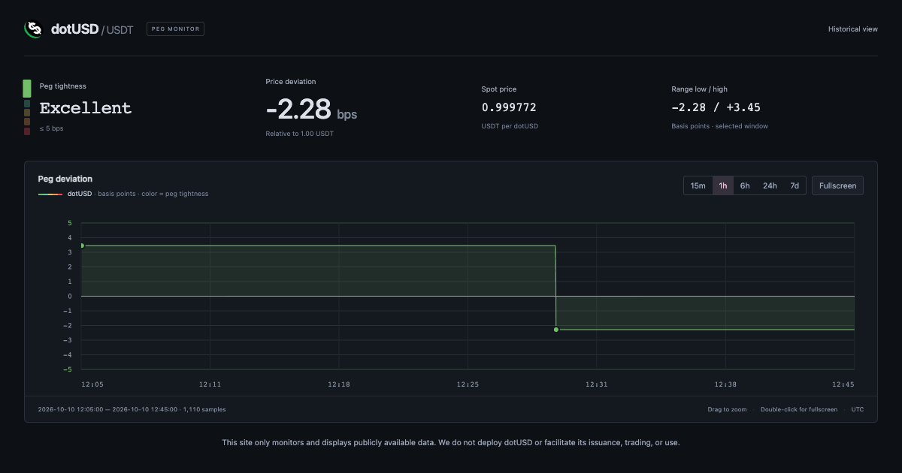

# dotUSD.info

See how closely dotUSD tracks USDT on Polkadot Asset Hub. The chart shows up to
seven days of pool prices, so you can explore recent moves and zoom in on a
particular period.

**[Open the live chart →](https://dotusd.info)**



Prices come from the dotUSD → DOT → USDT pools. They are quoted against USDT and
do not include trading fees or slippage. Timestamps are estimated, and missing
blocks appear as gaps in the chart. Production gradually repairs internal price
gaps and backfills total issuance from the Parity archive: both share a limit of
eight archive blocks per pass, with a six-second pause between passes. Missing
issuance is filled recent-first, even where price history is already complete.
Open charts pick up repairs automatically.

The retired CoinGecko comparison implementation is preserved on the
`preserve-coingecko` branch. Production serves only the pool-price chart;
the comparison page, API, and background worker are removed.

## Run it locally

The app uses Python 3.10+ and plain JavaScript. There is no frontend build step,
and archive pool decoding uses `xxhash`. Install the runtime dependencies:

```sh
just setup
```

These shortcuts require `just`. Without it, create the environment with
`python3 -m venv .venv` and install dependencies with
`.venv/bin/python -m pip install -r requirements.txt`.

You will need a data source, though: a Prometheus instance with the pool-price
history. The live data collector and Prometheus are not included in this repo.
The server expects the `arb_peg_dotusd_usdt` and `arb_peg_block_number` metrics,
both with the `clock="estimated_2s"` label.

If Prometheus is running locally, start the chart with:

```sh
just run --upstream http://127.0.0.1:9090/api/v1 --no-browser
```

Then open <http://127.0.0.1:3001>. Give the server a moment to load the price
history. Price history requires a working Prometheus data source.

For a local UI preview on <http://127.0.0.1:5137>, run:

```sh
just preview
```

This uses local Prometheus without an SSH tunnel and does not open a browser.
Issuance loads from the public Asset Hub RPC even if Prometheus is unavailable.
Additional server flags are forwarded, for example `just preview --port 5138`.
The recipe defaults to `.venv/bin/python`; set `PYTHON` to use another environment.

In **Settings**, enable **Total dotUSD issuance** to show a blue series on a
separate right-hand, linear axis in dotUSD units. Values use three significant
digits with compact suffixes (for example, `1.31M` or `1.76B`). The setting is saved locally.
An independent live poll reads the latest 15 finalized blocks from the public
Asset Hub RPC and refreshes every six seconds after each fetch. With
`--gap-repair-history PATH` (enabled in production), successful live samples and
historical issuance share the price-repair SQLite database, retain seven days,
and restore at startup. Historical filling follows the retained price block
range; it is gradual, not a guarantee of complete seven-day coverage.
Without that flag, issuance remains a recent-only, in-memory preview.

Issuance uses actual chain timestamps and renders as a thicker, solid blue line
without sample dots;
missing blocks stay disconnected, so isolated samples are not drawn.
Use the normal range buttons and drag-to-zoom controls for both series.
Issuance appears only in the graph and on its right-hand axis, with no separate
value label. Failed refreshes retain the last successful data.
`--hub-rpc URL` overrides the public RPC. Issuance can be previewed with the
command above even without local Prometheus; only price history remains unavailable.

If Prometheus is on another machine, connect through SSH:

```sh
just run --ssh-host user@host
```

Replace `user@host` with your SSH destination. The app forwards the remote
machine's port 9090 and opens the chart in your browser. Running
`just run` without options uses the SSH alias `server`.

For more options, including the listening port and archive path, run
`just run --help`. All arguments are forwarded to `server.py`.

## Working on the code

The backend lives in `server.py`. The chart is built from `index.html`, `app.js`,
`ranges.js`, and `style.css`. Restart the server after editing these files, since
it loads them once at startup.

The checked-in `VERSION` contains the release number and the first six bytes of
its SHA-256 code/asset hash, for example `1.0.0+abcdef123456`. After finishing
application changes, bump the version and refresh the hash together:

```sh
just release        # patch bump for fixes
just release minor  # minor bump for new features
just check-version
```

These commands require `just`; without it, use `python3 release.py --bump patch`
(or `--bump minor`) and `python3 release.py --check`.

Minor bumps reset the patch number to zero. Commit `VERSION` with the changes.
Tests and deployment reject stale release hashes. The hash covers the files in
`release.py`'s `RELEASE_FILES`, including runtime dependencies and the release
script itself; it excludes `VERSION` to avoid a circular hash, and excludes tests
and documentation. Add new runtime files to that list and the deployment copy list.

Run the tests from the repo root:

```sh
just test
```

`just test` uses the environment created by `just setup`; the direct equivalent
is `.venv/bin/python -m unittest discover -s tests -v`.
The tests run locally and do not need access to the live data collector. JavaScript
checks use Node.js, or JavaScriptCore on macOS. If neither is available, those
checks are skipped.

## Common commands

Run `just` to list the commands. Run `just setup` once before local development.

| Command | Purpose |
| --- | --- |
| `just setup` | Create `.venv` and install dependencies |
| `just run [options]` | Start the app locally with optional server arguments |
| `just test` | Run the test suite |
| `just preview [options]` | Preview locally on port 5137 without SSH or automatic browser launch |
| `just release [patch\|minor]` | Bump the version and refresh its hash; defaults to patch |
| `just check-version` | Verify the recorded release hash |
| `just deploy [host] [version-url]` | Check, test, deploy, and verify the public version |
| `just status [host]` | Inspect the deployed service |
| `just logs [host]` | Read its latest 50 log entries |

Deployment, status, and logs default to the SSH alias `server`. Deployment
requires a version number newer than the deployed one (a changed hash alone is
not enough), restarts the remote service, then checks `/version` every 5 seconds for up to
25 seconds, returning success when it matches the expected release or an error
on timeout. See the [deployment guide](docs/deployment.md)
for prerequisites and specialized backfill and repair procedures.

## Agent instructions

`AGENTS.md` is a relative symlink to this README. Keep contributor and agent
instructions here so they stay in sync.

- After completing application changes, run `just release` for fixes or
  `just release minor` for features. Run the bump after the final code edit so
  the recorded hash matches. Include the updated `VERSION` in the same commit.
- Deployment refuses unchanged or older version numbers and stops if the public
  version cannot be verified. Bump the version before redeploying.
- Before committing application changes, run `just check-version` and
  `just test` (after `just setup`). Resolve failures before committing.
- Add new runtime files to `RELEASE_FILES` in `release.py` and the copy list in
  `deploy/deploy.sh` so hashing and deployment include them.
- Documentation-only changes do not need a version bump or the full test suite.
  Verify links and `just check-version` instead.
- Never use `/` in Git branch names; use hyphens, such as
  `fix-footer-version`.
- Create a commit after each completed change. Commit only task-related changes
  and preserve unrelated work. Disable signing with
  `git -c commit.gpgsign=false commit --no-gpg-sign`.
- Do not add `Signed-off-by` or `Co-authored-by` trailers. Verify the resulting
  commit message because local hooks may append them, and remove any such
  trailers from your new commit.
- For printing tasks, use 97% scaling unless explicitly requested otherwise,
  and ensure the print pipeline does not apply additional automatic fitting.

## More details

- [How it works](docs/architecture.md): data loading, caching, and the price API.
- [Deployment and archive backfill](docs/deployment.md): running the app with
  systemd and Caddy, and importing older prices. The supplied configuration is
  for dotusd.info; adapt it for your own host. The optional backfill tool also
  needs `websocket-client` and `xxhash`.
- [Benchmarks](docs/benchmarks.md): performance measurements and how to repeat them.
